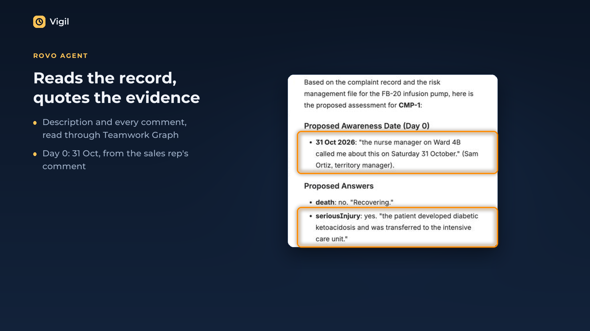
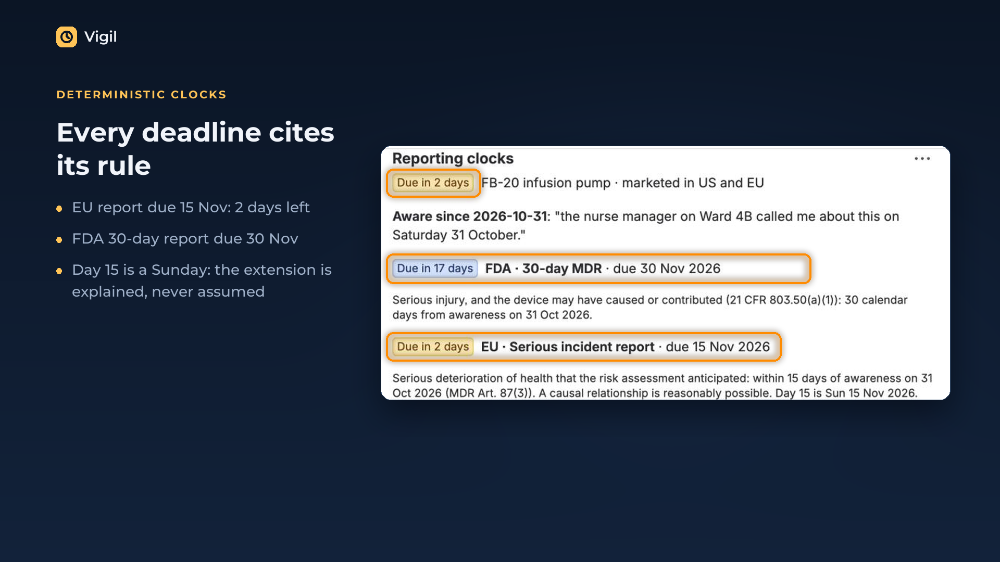
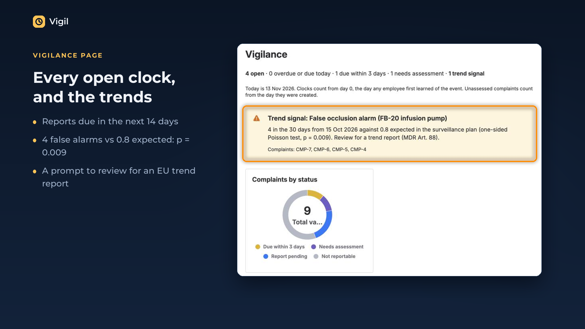
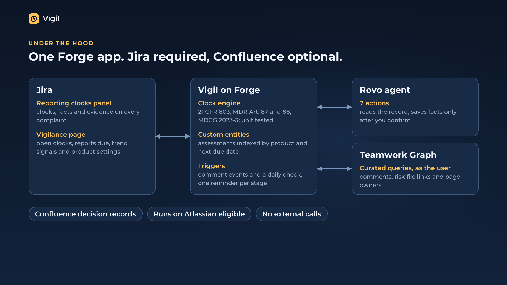

# Vigil

Every medical device complaint has a reporting clock. Vigil shows which regulator needs a report, by when, and why. A Forge app for Jira (Confluence optional) with a Rovo agent. The agent reads and quotes the record; Vigil's code computes every deadline.

- Demo video (3:11): https://youtu.be/VgACNnD0pTw
- Project page: https://devpost.com/software/vigil-u6fs43

## Why

When a medical device may have hurt a patient, the manufacturer has a legal deadline to report it. In the US, 21 CFR Part 803 allows 30 calendar days, or 5 work days when remedial action is needed to prevent an unreasonable risk of substantial harm. In the EU, the MDR (Article 87) allows 15 days, 10 days for a death or an unanticipated serious deterioration of health, and 2 days for a serious public health threat. Even when the manufacturer is unsure whether an event is reportable, it must still report within the limit.

The clock starts on day 0: the day any employee or representative first received the information, not the day the quality team opened the ticket. Those facts arrive late and scattered: a sales rep hears about an injury on a Saturday, a nurse's email mentions surgery, an engineer finds the root cause a week later. Vigil finds day 0 in the record, applies the rules, and shows its work.

## What it does

- **Reporting clocks on every complaint.** A Jira issue panel shows a clock for each regulator where the product is sold: the report type, the due date, the days left and the rule, for example "EU serious incident report due 15 Nov 2026 (MDR Art. 87(3))".
- **Reads the record with Rovo.** The Vigil agent reads the description and every comment through the Teamwork Graph API, proposes day 0 with a quote, and answers each reporting criterion with evidence.
- **Checks the risk management file.** Whether a serious deterioration was "unanticipated" decides between the EU 10-day and 15-day limits. Vigil follows the links from the product's risk management file to its hazard analysis, and the agent names the hazard that covers the harm.
- **People decide, code counts.** Nothing is saved until a person confirms the facts in Rovo's review card. Then code computes every clock: FDA 30-day (21 CFR 803.50(a)), FDA 5-day in work days skipping weekends and US federal holidays (803.53), FDA supplemental (803.56), and EU 15, 10 or 2 days (MDR Art. 87(3)-(5)).
- **Warns before the date passes.** Triggers re-check the clocks when a complaint changes, and a daily trigger catches time passing. When a report is due within 3 days or is overdue, Vigil comments once per clock and stage.
- **Vigilance page.** Every open clock, reports due in the next 14 days, complaints that still need an assessment, and trend signals for EU MDR Article 88 (a one-sided Poisson test per problem code; in the demo, 4 false occlusion alarms in 30 days against 0.8 expected gives p = 0.009).
- **Decision record in Confluence**, and a manual assessment form for teams without Rovo.

## Screenshots









## How it is built

| Path | What it is |
|---|---|
| `manifest.yml` | Forge modules: `rovo:agent` (7 actions), `jira:issuePanel`, `jira:globalPage`, a `trigger` on comment and update events, a daily `scheduledTrigger` |
| `src/engine/` | Pure engine, no Forge imports: calendar and work-day counts, US federal holidays 2026–2027, the reporting rules, the Poisson trend test |
| `src/services/` | Complaint assessment, clocks and reminder comments |
| `src/actions/` | Rovo actions |
| `src/platform/` | Jira, Confluence and Teamwork Graph calls |
| `src/store/` | Forge Custom Entities (assessments, indexed by product and next due date) and product settings |
| `src/frontend/` | UI Kit issue panel and global page |
| `research/` | The eCFR text of 21 CFR Part 803 (point in time 2026-11-01) and the source list |
| `test/` | 20 tests |

Teamwork Graph queries run as the current user (`jiraWorkItemComments`, `confluencePageLinkedConfluencePages`, `confluencePageOwners`). A missing scope returns empty rows instead of an error, so Vigil falls back to the Jira and Confluence REST APIs and labels the source.

Vigil makes no external calls. It stores complaint keys, dates, confirmed answers, short evidence quotes, sent-report references and product settings in Forge storage. It stores no account IDs, names or email addresses.

## Tests

```bash
npm test
```

20 tests with Node's built-in runner (Node.js 22 or later; no install needed). They include the OPM federal holiday schedules for 2026 and 2027 with observed dates, five-work-day counts across Veterans Day and Thanksgiving, the EU weekend rule, the reportability-date example in MDCG 2023-3, and Poisson tail values.

## Deploy your own copy

You need Node.js 22 or later, the [Forge CLI](https://developer.atlassian.com/platform/forge/getting-started/) and a Jira site where you are an admin (a free developer site works).

```bash
npm install
forge register
forge deploy -e development
forge install -e development --site your-site.atlassian.net --product jira
forge install -e development --site your-site.atlassian.net --product confluence   # optional
```

`forge register` writes your own app ID into `manifest.yml`. Then follow [docs/WALKTHROUGH.md](docs/WALKTHROUGH.md).

## Sources

- 21 CFR Part 803, eCFR point in time 2026-11-01: https://www.ecfr.gov/api/versioner/v1/full/2026-11-01/title-21.xml?part=803
- Regulation (EU) 2017/745 (MDR): https://eur-lex.europa.eu/legal-content/EN/TXT/HTML/?uri=CELEX:32017R0745
- MDCG 2023-3 Rev. 2 (January 2025), questions and answers on vigilance terms and concepts
- OPM federal holidays: https://www.opm.gov/policy-data-oversight/pay-leave/federal-holidays/
- Teamwork Graph curated queries: https://developer.atlassian.com/platform/teamwork-graph/curated-queries/

Vigil is decision support. It is not validated software, it does not replace a complaint handling procedure, it does not submit reports to any authority, and it is not legal advice.

## License

Apache-2.0. Built for Codegeist 2026. Most of the code, tests and documentation were written with Claude Code (Anthropic's AI coding agent). The demo data is fictional and the narration is synthetic.
